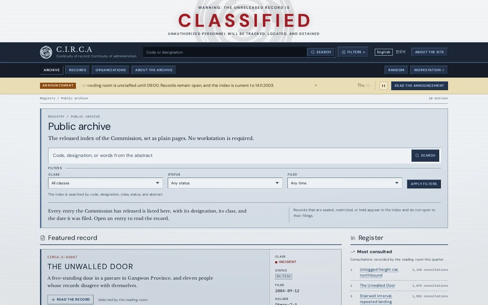
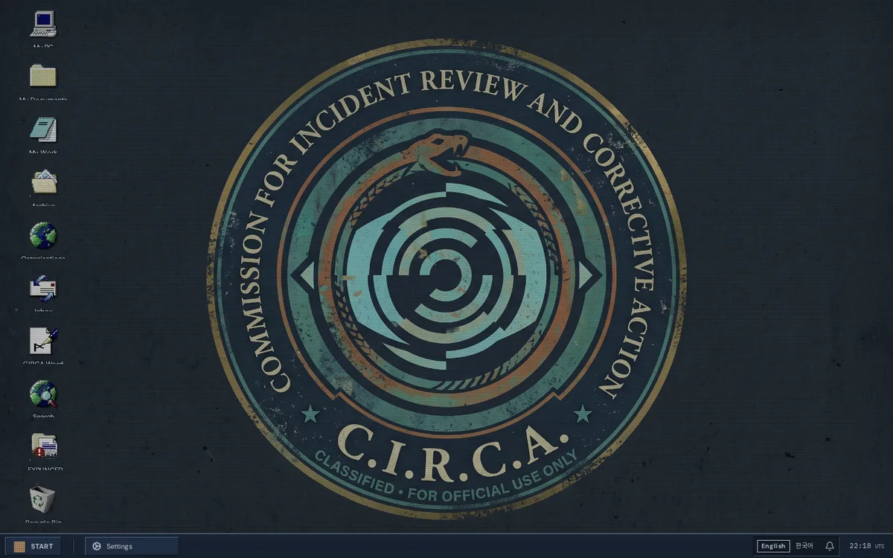

# CIRCA Archive

[](https://github.com/KavinduNirmal/circa-archive/actions/workflows/ci.yml)
[](https://github.com/KavinduNirmal/circa-archive/actions/workflows/codeql.yml)
[](LICENSE)

**A ghost story survives by being told. CIRCA gives it a filing system.**

CIRCA Archive is a collaborative horror-fiction project where readers become analysts and writers expand a shared universe through incident reports, exploration records, and organization dossiers. You enter the archive of the Commission for Incident Review and Corrective Action (C.I.R.C.A.), a bureaucracy that files the impossible. CIRCA does not decide truth. It decides what is on file.

An incident begins with someone's encounter with the unexplained. Follow-up records uncover patterns, invent rules, and sometimes contradict each other. Different organizations give the same horror different names; continuities let those accounts branch without erasing the original.

The project has two public faces. The **archive** is a server-rendered reading edition: search-first, readable without JavaScript, with record pages, an organizations directory, a guide, notes, and downloadable copies. The **workstation** is a period desktop for the same world: draggable and resizable windows, a Start menu, a taskbar, an emblem wallpaper, and a switchable CRT overlay. Its browser, mail client, file browser, record editor, and record reader all work over illustrative fixtures.

<p align="center">
  
  
</p>

## Project status

The current development milestone is **0.2.0**, recorded in the [changelog](CHANGELOG.md). It has not been tagged or published as a supported release.

CIRCA Archive is in pre-release development. The public archive and CIRCA/OS workstation let you explore illustrative records today. The .NET 10/PostgreSQL backend implements account registration, sign-in, cookie sessions, and authorization policies, with personal access integrated into the Next.js client. Archive content still comes from local fixtures; persistent records, notes, publishing, and moderation remain in development. The full platform design in [ARCHITECTURE.md](ARCHITECTURE.md) remains a draft, and no release is currently supported.

## What is in the repository

- **Public archive.** A reading edition with server-rendered record pages, organization dossiers, search, notes, and Markdown-derived downloads.
- **CIRCA/OS workstation.** A windowed desktop shell with five working applications over archive fixtures.
- **Personal access.** Account registration, sign-in, and server-verified sessions backed by the .NET authentication service.
- **Bilingual interface.** English and Korean catalogues, locale-aware routing, and a language switcher that preserves the current page. Filed content stays in the language it was filed in.
- **Record renderer.** A shared Markdown pipeline for frontmatter, tables, redactions, references, and paper-like reading.
- **Verification.** Vitest unit and interaction tests, Playwright browser tests, repository checks, and GitHub Actions on every pull request.

## Stack

| Area | Technology |
| --- | --- |
| Frontend | Next.js 16, React 19, TypeScript, Tailwind CSS 4, shadcn/ui |
| Tooling | Bun 1.3.14, ESLint, Vitest, Playwright |
| Backend | .NET 10 Minimal APIs, EF Core, PostgreSQL; SignalR and S3-compatible storage planned |

## Repository layout

| Path | Purpose |
| --- | --- |
| [client/](client/README.md) | Next.js application: public archive, project pages, and CIRCA/OS workstation |
| [backend/](backend/README.md) | Modular monolith API and persistence, including the integrated authentication service |
| [admin/](admin/README.md) | Reserved for administration tooling |
| [docs/](docs/README.md) | Branch model, architecture decision records, publishing checklist, and setting documentation |
| [scripts/](scripts/README.md) | Repository README and whitespace checks |
| [tests/](tests/README.md) | Bun tests for repository tooling |
| [.github/](.github/ABOUT.md) | Workflows, issue and pull request templates, and review routing |
| [ARCHITECTURE.md](ARCHITECTURE.md) | Draft architecture, schema, and API contracts |
| [CHANGELOG.md](CHANGELOG.md) | Notable changes and release notes |
| [CONTRIBUTING.md](CONTRIBUTING.md) | Contribution workflow and verification requirements |
| [SECURITY.md](SECURITY.md) | Private vulnerability reporting and contributor security practices |
| [SUPPORT.md](SUPPORT.md) | Where to ask questions and report problems |
| [NOTICE](NOTICE) | Third-party asset licensing |
| [LICENSE](LICENSE) | MIT license for original code and documentation |

Empty placeholder folders may not appear in a fresh clone; Git tracks files rather than directories.

## Run locally with Docker

The root [`compose.yaml`](compose.yaml) runs PostgreSQL, the .NET API, and the
Next.js development server. Requires Docker with Compose v2.20 or newer. For a
fresh clone, copy `.env.example` to `.env` at the repository root and set
`CIRCA_AUTH_SIGNING_KEY` and `CIRCA_POSTGRES_PASSWORD` to separate random values
(generate each with `openssl rand -hex 32`). The `.env` file stays out of Git.

```sh
docker compose up --build --detach --wait
```

| Service | Local address | Container address |
| --- | --- | --- |
| Website | <http://localhost:3001> | `circa-client:3001` |
| API | <http://localhost:5040/api/v1/> | `circa-api:8080` |
| PostgreSQL | `localhost:5432` | `circa-db:5432` |

Compose sets server-only `API_ORIGIN=http://circa-api:8080`. Browser `/api/*`
requests stay on the website origin and Next forwards them to the API. A frontend
running directly on the host defaults to `http://localhost:5040`, matching the
API's published port. All published ports bind to the local machine. Override
`CIRCA_CLIENT_PORT`, `CIRCA_API_PORT`, or `CIRCA_DB_PORT` in `.env` if needed; a
host-run frontend needs `API_ORIGIN` in `client/.env.local` if the API host port
changes. The backend origin allowlist follows the configured website port.

The API initializes a fresh local database on first startup. Named volumes retain
accounts and refresh-token protection keys across restarts. Existing schemas are
not upgraded automatically; follow the [profile upgrade guide](backend/src/Modules/Auth/Circa.Auth.Infrastructure/Persistence/README.md#schema-upgrade-and-verification)
when reusing an older auth database. Redis is not used by the current app.

Use `docker compose logs -f` for logs and `docker compose down` to stop while
retaining data. Source is copied into images, so rebuild after editing. The client
runs in development mode for its existing API rewrites; this is a local setup,
not the production reverse-proxy deployment. The client health check verifies the
API through Next before `--wait` completes.

If startup reports that database port 5432 is already in use, set
`CIRCA_DB_PORT=5433` (or another available host port) in the root `.env` and run
the startup command again. Docker services still connect to `circa-db:5432`;
host database tools must use the configured host port.

If the API exits with `Name or service not known` for `circa-db`, check
`docker inspect circa-local-circa-db-1 --format '{{json .NetworkSettings.Networks}}'`.
A running database with no network attachment can pass its internal health
check while remaining unreachable by the API. Restore the Compose network
attachments with `docker compose up --detach --force-recreate --wait` after
resolving any host port conflict. This preserves named data and key volumes;
do not use `down --volumes` to repair connectivity.

## Getting started

Install Bun 1.3.14 and Node.js 20.9 or newer. From the repository root:

```sh
bun install --frozen-lockfile
bun run prepare
bun run check
bun run test
```

Install the frontend separately and start the development server:

```sh
cd client
bun install --frozen-lockfile
bun run dev
```

The application serves <http://localhost:3001>. A bare path redirects to the reader's language, then to the public portal. Public archive content can be explored without the API; to use personal accounts, configure and run the [backend](backend/README.md) and follow the [client authentication setup](client/src/lib/auth/README.md).

Useful checks:

```sh
bun run check:client                  # frontend lint, typecheck, and unit tests
bun run --cwd=client build            # production build
cd client && bun run test:e2e         # Playwright browser tests
```

Playwright needs Chromium: `cd client && bunx playwright install chromium`.

Husky runs the staged repository checks, tooling tests, and frontend checks before a commit. `bun run precommit` reproduces them. Every authored folder needs a `README.md` describing its responsibility, structure, boundaries, and usage; `bun run check` enforces this. `.github` uses `ABOUT.md` because GitHub treats `.github/README.md` as the repository README.

## Branching and releases

`develop` is the default integration branch. `main` holds released code. Work happens on short-lived branches such as `feature/record-search`, `fix/mail-sort`, or `docs/api-contracts`, and reaches `develop` through a pull request. Releases use `release/<version>` and hotfixes use `hotfix/<version>`; both merge to `main` and are tagged `v<version>`.

The full branch model, protection rules, release checklist, and hotfix procedure are in [docs/GITFLOW.md](docs/GITFLOW.md).

## Contributing

Read [CONTRIBUTING.md](CONTRIBUTING.md) and the [Code of Conduct](CODE_OF_CONDUCT.md) before opening a pull request. Use the issue forms for bugs, proposals, and documentation gaps. Report vulnerabilities privately through [SECURITY.md](SECURITY.md), never in a public issue.

Story authors can read the [Author guide](docs/AUTHOR_GUIDE.md) for the pre-release collaboration framework, including Core Rules, character consent, independent filings, and adoption.

Good early contributions include refining archive domain contracts, connecting fixture-backed features to persistent services, improving accessibility, and expanding the original record corpus.

## License and third-party assets

Original source code and documentation are available under the [MIT License](LICENSE). Contributions must be original or compatible with that license.

Some visual assets are not MIT-licensed:

- The Windows 98 shortcut icons in `client/public/icons/` are Microsoft artwork used as placeholder shell art. Replace or license them before distributing a release.
- The supplied government-emblem wallpaper has not been cleared for redistribution. Treat it as excluded from the MIT grant until its provenance and license are confirmed.
- Bundled fonts and the shadcn/ui primitives retain their own licenses.

Read [NOTICE](NOTICE) and [client/THIRD_PARTY_NOTICES.md](client/THIRD_PARTY_NOTICES.md) before redistributing the project or any bundled asset.
