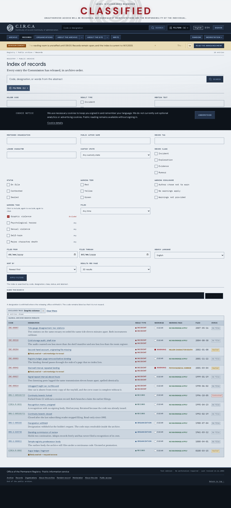
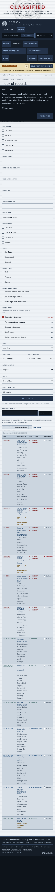
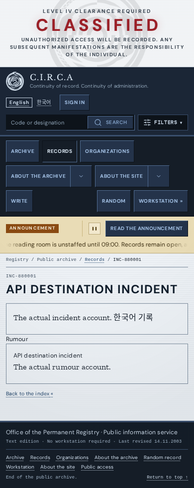

# Global search verification

Verified 2026-10-26 against the local global search implementation plan, including
its later phase 4 decisions. Public contracts are recorded in
[ARCHITECTURE.md](../ARCHITECTURE.md); the local planning document is not published.

## Contract and implementation

| Plan area               | Implementation and verification                                                                                                                                                                                                                                                                                           |
| ----------------------- | ------------------------------------------------------------------------------------------------------------------------------------------------------------------------------------------------------------------------------------------------------------------------------------------------------------------------- |
| URL state               | Shared client parser/serializer, repeated facets, exclusion precedence, cosmetic holder, explicit English/Korean language, canonical links, bounded dates and encoded URL size. Query tests cover normalization and legacy/invalid notices.                                                                               |
| Search read model       | Parameterized PostgreSQL UNION across incidents, records, organizations, characters, and recoveries. Request, schema, vocabulary, client contract, filter, ranking, total, and facet tests pass.                                                                                                                          |
| Visibility              | Restricted, erased, and tombstoned entries are excluded before counts. Sealed incident bodies never enter search; sealed record bodies require explicit approved, dated access. Authorship and moderation roles do not bypass access. Erased character/organization relationships cannot satisfy public resolved filters. |
| Destinations            | API-backed incident/record readers, organization directory dossiers, character dossiers, recovery dossiers, rumour anchors, native incident acknowledgment, and persistent sealed-record access requests. API browser tests cover all enabled types.                                                                      |
| Expansion               | Normalized organization mentions, public author display names, record tags, character relationships, recovery custody, stable cursor pagination, 320 ms suggestions, and at most 20 named browser-local saved searches.                                                                                                   |
| States and localization | Empty/no-match results, reserved/missing codes, discarded-filter notices, API errors, rate limits, English/Korean controls, no-JavaScript GET submission and reading, and mobile layouts.                                                                                                                                 |
| Rollout                 | `SEARCH_SOURCE` remains `fixture` by default. API integration uses disposable PostgreSQL and the actual API. Fixture relationships use explicit optional public metadata rather than invented organization resolution.                                                                                                    |

## Gaps fixed during verification

- Continuation cursors rejected their own previous boundary and exceeded the
  transport limit for Korean titles. Tokens now use bounded Brotli compression,
  validate one previous boundary and the selected sort, and reject oversized
  decompressed input. All four sorts traverse three pages without duplicates.
- Removing a repeated facet retained its old cursor. All chip removals reset
  pagination; HTTP previous links also preserve the bounded offset fallback.
- Signed-in readers shared the guest IP budget. Search now partitions authenticated
  user budgets at 120 requests/minute and guest IP budgets at 60. Authentication
  runs before rate limiting; live-session validation still controls sealed content.
- Exact holder matches did not outrank newer prefix matches in relevance order.
- Reversed dates and oversized encoded Unicode filters reached the strict API.
  The page parser now drops them and explains normalization.
- Relationship filters could match erased characters or organizations.
- Fixture expansion filters returned no matches regardless of supplied metadata.
- Suggestions ignored changes to the language control, and local form state did
  not reliably follow committed navigation.
- Saved searches used the current page path instead of the canonical index, and
  blocked storage writes threw. Saved links now target the locale's index and
  remain usable in memory when storage is blocked.
- React effect lint failures and stale browser/test role expectations were fixed.

## Recorded implementation choices

The later phase 4 decisions supersede the plan's original exclusions of saved
searches, suggestions, and character/recovery destinations. All five result types
are enabled because real API destinations now exist.

The inherited route-level loading boundary was removed after API browser testing
showed an unresolved streaming skeleton with JavaScript disabled. Completed server
HTML takes priority over that suggested loading mechanism. The route error boundary
remains, with scoped localized recovery messages. Search components remain together
in the existing archive components rather than being split solely to match the
plan's suggested filenames. The production route passes fetched outcomes to the
presentational global-search view; older fixture component props remain for
compatibility with the existing component suite.

## Reproduce verification

```sh
bun run check
bun run test
bun run check:client
CIRCA_LOW_RESOURCE=1 bun run --cwd=client build
DOTNET_PROCESSOR_COUNT=2 dotnet test backend/Circa.sln -m:1 --logger 'console;verbosity=detailed'
PLAYWRIGHT_BROWSERS_PATH="$PWD/.pw-browsers" bun run --cwd=client test:e2e:search
PLAYWRIGHT_BROWSERS_PATH="$PWD/.pw-browsers" CIRCA_E2E_PORT=3002 CI=1 bun run --cwd=client test:e2e -- --workers=1
```

Run production builds and browser suites sequentially: building clears nested
`.next` test output. Browser tests require Chromium; database tests require Docker.

The 10,000-document benchmark measures ten requests per scenario after warmup,
with a 750 ms p95 regression ceiling. Captures below use illustrative fixtures and
isolated API test data.

## Screenshots






